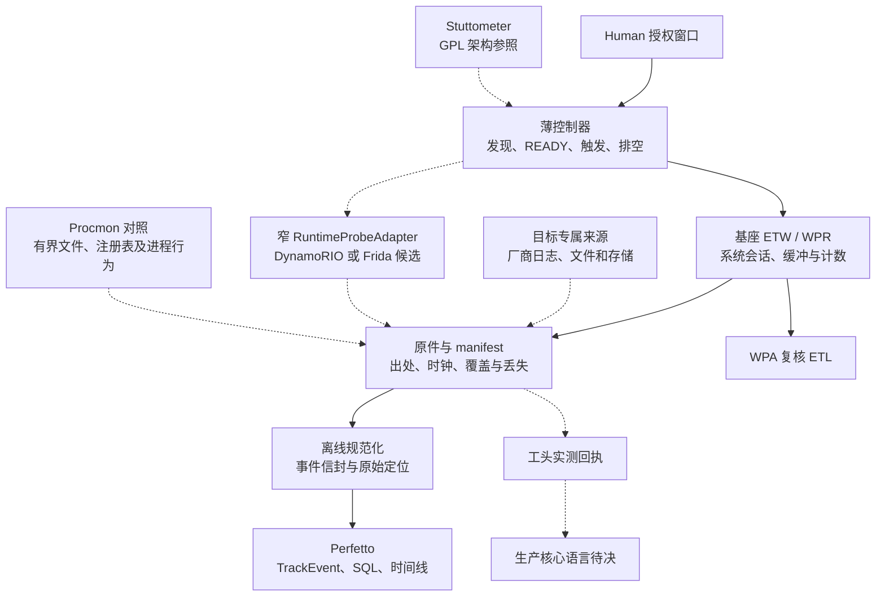
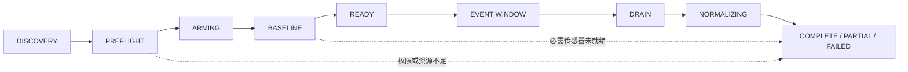

# 架构与证据流

实线表示已采纳的架构边界与证据流。虚线表示候选接入、对照或实测依赖。以下是设计，当前原型与验收入口见 [README](../README.md)。

## 层与接口

| 层 | 裁决与待验证项 |
| --- | --- |
| Windows 基座 | ETW 管理缓冲和会话计数，WPR 提供原生 profile 与录制，WPA 复核 ETL。循环覆盖是保留语义，应从 ETW 丢失、消费者积压和导出错误分别计量。源端过滤要按 provider、OS 和 profile 验证。 [ETW 会话字段](https://learn.microsoft.com/en-us/windows/win32/etw/event-trace-properties) · [WPR 命令手册](https://learn.microsoft.com/en-us/windows-hardware/test/wpt/wpr-command-line-options) |
| 控制面 | 工具驱动、权限/进程闭包、READY、trigger、drain、manifest。现有 Python 属于这类 glue，生产控制面与需要自有热路径的情况分别比较。 |
| 架构参照 | Stuttometer 提供环形保留、触发前后窗口和时钟映射设计的参照。GPL 代码及构建物不引入本项目。 [上游许可](https://github.com/xdr0p/stuttometer/blob/1999d3c75d87c24b4b217110dbadcd08d5e38d22/LICENSE) |
| 交叉验证 | Procmon 是文件/注册表/进程线程的 ground-truth oracle，限定其支持的事件和实际捕获配置。保留 PML，CSV 为派生。合成 fixture 的生成序号作为独立分母。 [Sysinternals Procmon](https://learn.microsoft.com/en-us/sysinternals/downloads/procmon) |
| 可选运行时探针 | DynamoRIO/Frida 是 RuntimeProbeAdapter 候选。只有系统层和日志无法区分假设时，才按目标/version/覆盖选择一个有界传感器。具名记录附加开销、探针盲区和丢失；默认关闭。 [DynamoRIO 文档](https://dynamorio.org/page_drcachesim.html) · [Frida Stalker](https://frida.re/docs/stalker/) |
| 分析与交换 | 以原始来源引用建立事件信封，保留时钟域与未知值，再派生 Perfetto TrackEvent/ClockSnapshot、SQL 与 UI。Python Trace Processor 客户端可承载离线查询与关联。 [Perfetto TrackEvent](https://perfetto.dev/docs/instrumentation/track-events) · [多时钟同步](https://perfetto.dev/docs/concepts/clock-sync) · [Python API](https://perfetto.dev/docs/analysis/trace-processor-python) |

## 一次录制的状态机

在一次性事件之前验证权限、进程实例、采集配置、噪声、空间和时钟。为每个传感器记录就绪状态与未覆盖原因。START 请求、实际 READY、事件窗口、STOP 请求和 drain 分别记时。

**证据口径。** 用频率、启动域、校准样本区间与误差保存 QPC 原始 tick。同一数值或不确定区间相交时保留排序不确定。进程身份包含 host/boot/PID/开始证据，基线枚举无法区分 PID 复用时保留未知。文件 IO、页/WAL 变化、逻辑提交和业务含义分级。ETL/PML 或其他原件保留 hash 和稳定 locator，传感器各自记可用区间、计数与空缺，分析导出能反查到原件。 [QPC 时间戳](https://learn.microsoft.com/en-us/windows/win32/sysinfo/acquiring-high-resolution-time-stamps) · [SQLite WAL 格式](https://www.sqlite.org/fileformat2.html#walformat)

**验收。** 按合成 [验证计划](VALIDATION.md) 对账，按 [原生 ETW 基线](https://github.com/youling/TraceScalpel/issues/3) 验证原件、覆盖、时钟和扰动。生产 Recorder 语言由同条件测量决定。
