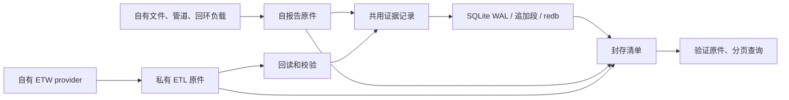

# Windows 证据 MVP

同一程序提供自有负载自报告、进程内私有 ETL、持久化和封存查询。原生 ETL 在 Windows 内置的私有会话记录自有 provider 的 64 条编号标记，停采后从 ETL 回读。传感器范围为此 provider 与进程，系统 IPC、文件、磁盘和网络 provider 的实测归入 [#3](https://github.com/youling/TraceScalpel/issues/3)。[Windows 私有会话](https://learn.microsoft.com/en-us/windows/win32/etw/configuring-and-starting-a-private-logger-session)



## 调用

为可信的本机 Agent 创建一个可写的专用目录。该目录由运行方控制和清理。stdin/stdout 使用逐行 JSON-RPC，既有 `camera.run_fixture` 继续返回即时自报告。

### 采集入口预检

`tracescalpel-capture.exe` 嵌入 Windows `requireAdministrator` 清单。从 Windows Shell 启动时，由系统在进程创建前请求授权；以 Agent 的 stdio 方式调用时，先启动管理员终端或已获授权的宿主，再启动该入口。普通令牌直接使用 CreateProcess 时，Windows 可返回 740。采集入口先检查进程令牌与配置目录，再打开 stdio 服务。系统 provider 的启用和正控 READY 仍在 [#3](https://github.com/youling/TraceScalpel/issues/3) 的实时采集验收内。常规 `tracescalpel.exe` 使用调用者权限提供自有负载及封存查询。 [MSVC UAC 清单](https://learn.microsoft.com/en-us/cpp/build/reference/manifestuac-embeds-uac-information-in-manifest?view=msvc-170)

`camera.inspect_storage` 可在两种入口中只读检查 `TRACESCALPEL_EVIDENCE_DIR` 实际所在卷，返回令牌提升状态、文件系统、可用空间、分配单元及逻辑和物理扇区信息。平台未提供的字段为 null。卷探测在预检与显式查询时执行。

```powershell
cargo build --locked
$evidence = New-Item -ItemType Directory -Force -Path .\target\evidence-example
$env:TRACESCALPEL_EVIDENCE_DIR = $evidence.FullName
$env:TRACESCALPEL_FIXTURE_DIR = $evidence.FullName

$reply = '{"jsonrpc":"2.0","id":1,"method":"camera.record_fixture","params":{"backend":"segments","source":"etw_owned"}}' |
  .\target\debug\tracescalpel.exe | ConvertFrom-Json
$id = $reply.result.capture_id

@{jsonrpc='2.0'; id=2; method='camera.verify_capture'; params=@{capture_id=$id}} |
  ConvertTo-Json -Compress | .\target\debug\tracescalpel.exe

@{jsonrpc='2.0'; id=3; method='camera.query_events'; params=@{capture_id=$id; limit=16}} |
  ConvertTo-Json -Compress | .\target\debug\tracescalpel.exe
```

- `camera.record_fixture` 需要 `backend`，可选值为 `sqlite`、`segments`、`redb`。 `source` 可选 `etw_owned` 或默认的 `fixture_self_report`。原件和索引完成后写封存清单，二者各有 SHA-256。索引采用 SQLite WAL FULL、校验帧同步写或 redb Immediate。私有 ETL 的上限为 1 MiB。
- `camera.verify_capture` 回读封存清单和对应原件、索引、ETW 回执，检查摘要。只读查询可由新的 Agent 进程完成。
- `camera.query_events` 支持进程 ID、半开 QPC 窗和 1 到 128 条的分页，省略时间窗时使用整个已封存窗口。下一页使用返回的 `next_cursor` 和相同的查询条件。游标包含封存快照、窗口和筛选条件绑定的查询身份与继续位置。覆盖状态独立于返回条数，区分 `complete`、`partial` 和 `outside_capture`。这里的 `complete` 指声明的自有来源与捕获窗口。

## 计时与来源

ETL 记录保存 Windows 发出的原始 QPC tick。私有 ETL 起止各做一次 `QPC → GetSystemTimePreciseAsFileTime → QPC` 采样，自报告保存开始锚。锚的 QPC 前后界说明 UTC 读数的采样区间，外部授时偏差仍需单独量测。原始 tick、计数器频率和 UTC 读数以十进制字符串传输。本机时钟、抓包点的时钟和协议字段时间各自有来源与适用范围。 [Windows 高分辨率时间戳](https://learn.microsoft.com/en-us/windows/win32/sysinfo/acquiring-high-resolution-time-stamps) · [TCP 时间戳](https://www.rfc-editor.org/rfc/rfc7323#section-5.4)

## 首轮同源比较

Windows build 26300、ReFS、Rust 1.99.1 release。三个后端各使用 32,768 条记录、每条 96 B 载荷、256 次 128 行持久提交和同一窗口查询序列。计时覆盖后端接口。一次运行的结果如下。

| 后端 | 行/秒 | 批提交 p95 | 查询 p95 | 封存文件 |
| --- | ---: | ---: | ---: | ---: |
| SQLite WAL FULL | 83,980 | 4.47 ms | 0.130 ms | 5.32 MiB |
| 二进制追加段 | 135,816 | 1.08 ms | 0.382 ms | 3.90 MiB |
| redb Immediate | 71,240 | 4.57 ms | 0.091 ms | 8.42 MiB |

这些是本机固定批次的存储结果。原生多源捕获、持续压力、满盘、断电恢复和混合读写另按 [#5](https://github.com/youling/TraceScalpel/issues/5) 测量。

```powershell
cargo test --locked
cargo test --release --locked compare_storage_backends -- --ignored --nocapture
```

## 私有 ETW 开销对照

同一自有 provider 交替关闭和启用 ETL，31 对试验各发 64 条编号事件，回读 1,984/1,984 条，四类丢失计数为零。每条标记的计时含两次 QPC 读取，关闭约 27 ns，启用约 106 ns，配对中位增量约 80 ns。每份 ETL 为 32 KiB，停采并关闭 ETL 的中位数为 309 ms。另用 15 批各 20 万次读取测得本机 QPC 和精确 FILETIME 的批均值中位数约 11 ns 与 16 ns。这些成本来自低负载私有会话和本机计时源。系统 provider 和真实多源高峰的开销由后续同负载对照给出。

```powershell
cargo test --release --locked measure_owned_etw_and_clock_calls -- --ignored --nocapture --test-threads=1
```

## Windows 系统 Provider 正负控

独立 Windows 托管 CI 使用常规 ETW 会话记录系统进程与文件 provider。测试只对照自有子进程和同轮临时文件，发布汇总、原始 QPC 检查结果和丢失计数。事件 ID 和 keyword 用于缩小记录范围，回读时以自有进程与文件身份确认命中。会话使用唯一名称、有限缓冲和有限 ETL，停止时只控制本次创建的会话。原件仅存于临时测试目录。

本实验用封存回放验证命中。实时正控通过后打开用户观察窗口的 READY 验收另列在 [#3](https://github.com/youling/TraceScalpel/issues/3)。 [Windows 系统 Provider](https://learn.microsoft.com/en-us/windows/win32/etw/system-providers) · [Windows 托管 CI 权限](https://docs.github.com/en/actions/reference/runners/github-hosted-runners#administrative-privileges)
